# Diego Andrés Ariza

**Full-Stack Developer · Systems Engineering Student**

I build end-to-end products: the data model, the API behind it, and the interface people actually use.

📍 Valledupar, Colombia &nbsp;·&nbsp; 🟢 Open to opportunities

## 👨‍💻 About

I'm 21, a Systems Engineering student at **Universidad Popular del Cesar**, and a freelance
full-stack developer. I like owning the whole slice of a product: the data model, the API
behind it, and the interface on top of it.

- 🧩 Most of my work lives in private repos: **electronic invoicing (POS)**, **political campaign platforms** and **e-commerce**.
- 🎯 Focus: backend architecture, relational databases and clean REST APIs.
- 🛠️ Day-to-day stack: **Vue · Nuxt · NestJS · PostgreSQL**.
- 🤝 Open to full-stack roles and collaborative projects.

## 🛠️ Tech Stack

  

Also worked with: Oracle · SQL Server · MySQL · MongoDB · Dart

## 🚀 Featured Work

| Project | What it does | Stack |
| :-- | :-- | :-- |
| **Electronic Invoicing POS** · `private` | Point-of-sale system for a Colombian business: inventory, cash register, customers and reports, with DIAN electronic invoicing through Alegra. | NestJS · PostgreSQL · Vue |
| **Political Campaign Platform** · `private` | Platform for a local political campaign: supporter registry, territory tracking and field reporting. | NestJS · PostgreSQL · Vue |
| **E-commerce** · `private` | Storefront and admin panel with catalog, orders and online payments through Wompi. | Vue · NestJS · Redis |

## 📊 GitHub

  <picture>
    <source media="(prefers-color-scheme: dark)" srcset="./profile/stats-dark.svg" />
    
  </picture>
  <picture>
    <source media="(prefers-color-scheme: dark)" srcset="./profile/top-langs-dark.svg" />
    
  </picture>

## 📫 Let's Connect

  

Thanks for stopping by.

